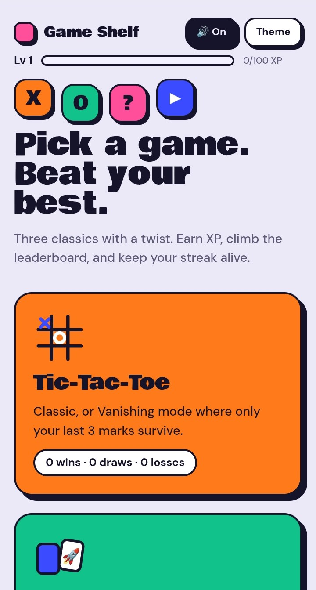
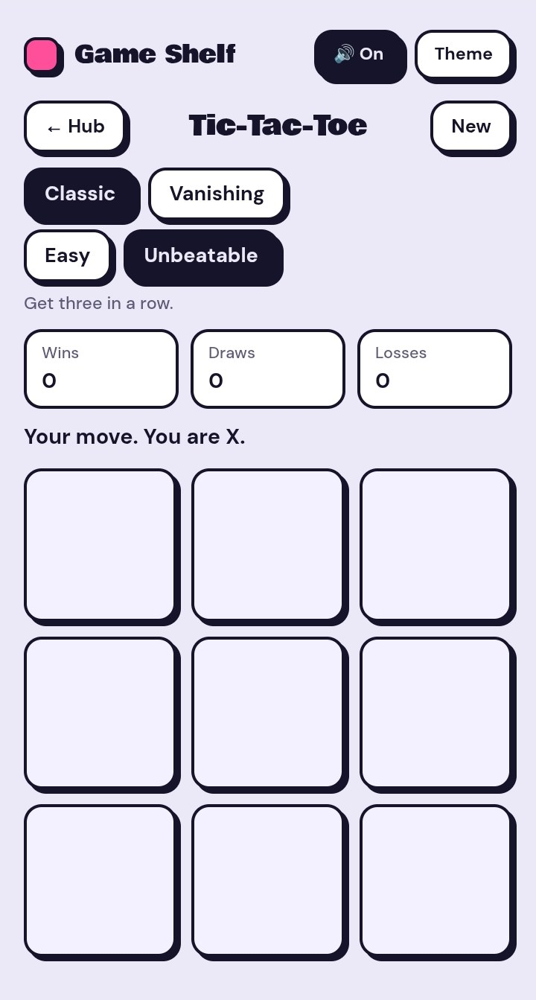
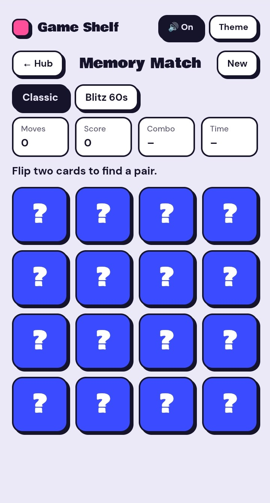
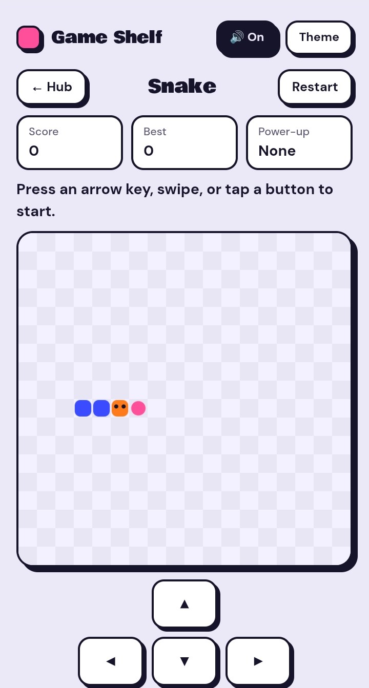

# Game Shelf


A small arcade hub (Tic-Tac-Toe, Memory Match, Snake) with a SQLite-backed leaderboard API.
Zero npm dependencies: it runs on Node's built-in `http`, `node:sqlite` and `node:test`.

## Screenshots

<p>




</p>

Design rationale, motion and accessibility notes: [docs/DESIGN.md](docs/DESIGN.md).

## Run it

```bash
node --version   # needs 22.13 or newer
npm start        # http://localhost:3000
npm test
```

Set `PORT` or `DB_FILE` to change the port or database location.

## Game modes

- **Tic-Tac-Toe:** Classic, or **Vanishing** where each player keeps only their last 3 marks (it can never end in a draw).
  The CPU searches ahead with negamax, and Easy mode plays randomly.
- **Memory Match:** Classic ranks by fewest moves. **Blitz** gives 60 seconds, a combo multiplier for chained matches,
  and a fresh board each time you clear one.
- **Snake:** every 3rd apple adds a rock, and every 5th spawns a power-up (slow-mo or double points).
- **Shelf XP:** every game earns XP toward levels, with confetti, haptics and toasts as feedback.

## Deployment

`render.yaml` (Render blueprint), a `Dockerfile` and a GitHub Actions workflow (`.github/workflows/ci.yml`) are included.
Environment variables: `PORT` (3000), `DB_FILE` (`./data.sqlite`) and `TRUST_PROXY` (0).
Step by step, including free-tier limits: [docs/DEPLOY.md](docs/DEPLOY.md).

Live demo: _add the address after deploying_

## Architecture

```
server/db.js      SQLite access, schema, per-game score rules
server/app.js     HTTP routes, validation, rate limiting, static files, security headers
server/index.js   entry point
public/           the client: index.html, styles.css, js/ (logic.js holds the pure game rules)
test/             API and game-logic tests (node:test)
```

The client talks to the API through `public/js/api.js`. If the API is unreachable (for example when
the files are hosted on a static site) it falls back to a leaderboard stored on the device.

## API

| Method | Path | Notes |
| --- | --- | --- |
| GET | `/api/scores?game=snake\|memory\|blitz` | Top 10. Memory ranks fewest moves first, the others highest score first. |
| POST | `/api/scores` | JSON `{game, player, score}`. Returns 201, or 422 if invalid, 429 if rate limited. |

## Design decisions

- **Validation on the server:** score ranges per game, names stripped to letters, numbers, spaces, `_` and `-`.
- **Safety:** parameterised SQL, request size cap, per-IP rate limit, path-traversal guard, CSP header.
- **Accessibility:** skip link, live regions for game status, keyboard play, focus moved on navigation,
  `prefers-reduced-motion` and light or dark theme respected.
- **Trade-off:** scores are self-reported by the browser, so the leaderboard is for fun, not anti-cheat.

## Next steps

Accounts, replayable server-side score checks, more games, and a CI workflow that runs `npm test`.
